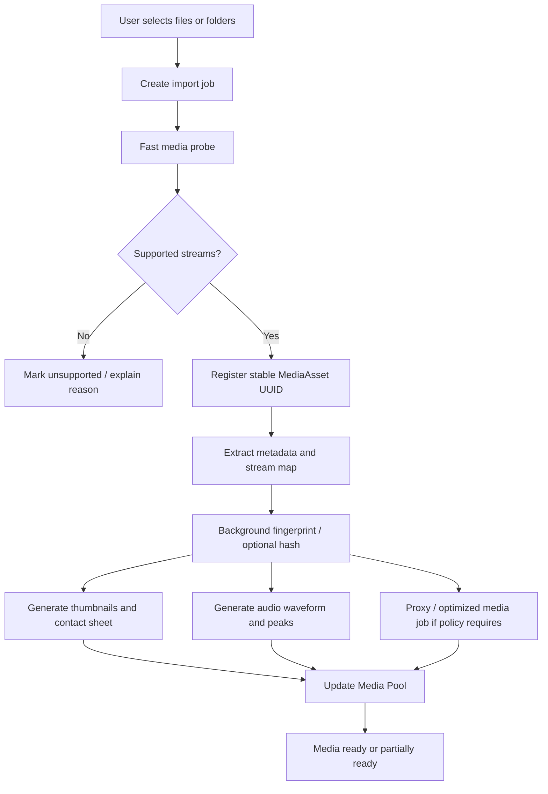
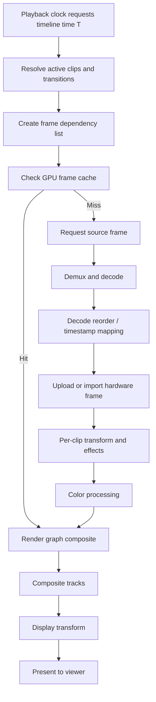
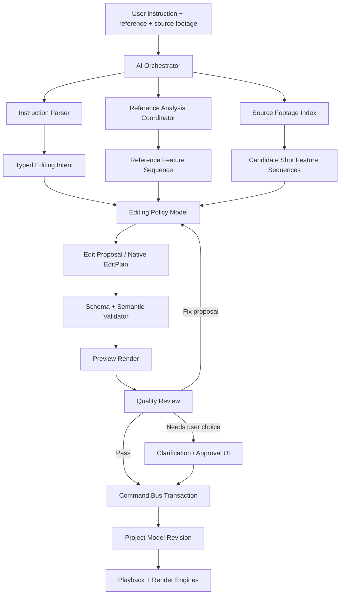
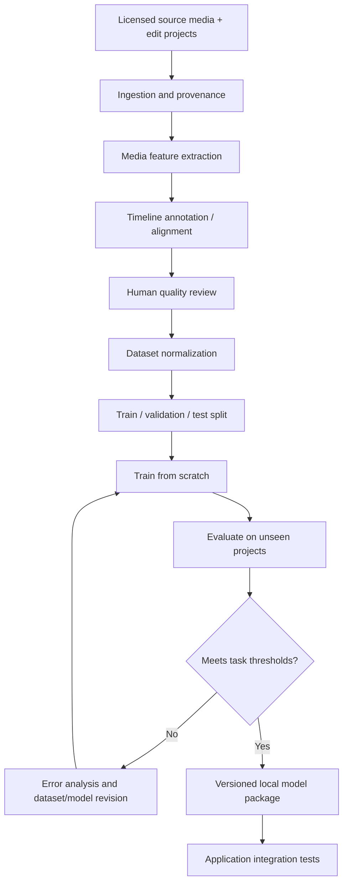
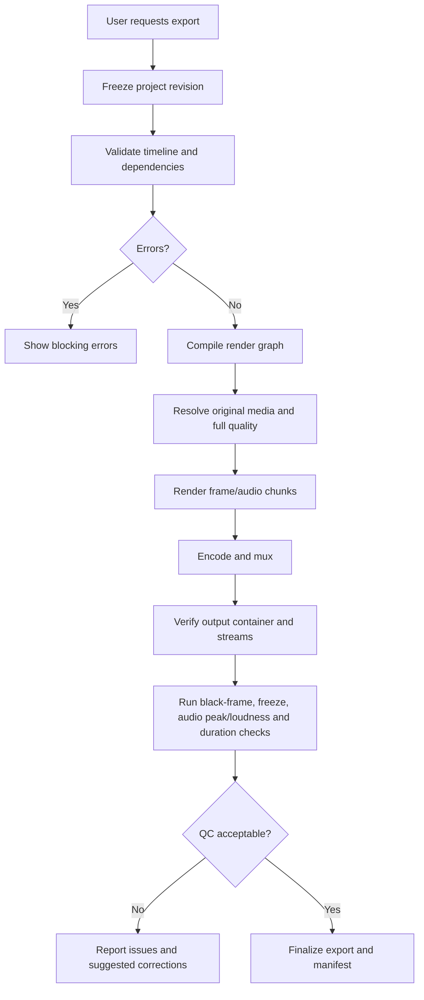

# Autonomous Professional Non-Linear Video Editor
## Architecture, AI Integration, Engineering Workflow, Pipelines, and Development Plan

**Document status:** Recommended baseline architecture  
**Prepared:** 6 November 2026  
**Scope:** A local-first, GPU-accelerated, cross-platform professional non-linear editor (NLE) with a custom-trained autonomous editing intelligence.

---

## 0. Executive decision

The product is not an AI wrapper around VN, Kdenlive, DaVinci Resolve, or FFmpeg. It is a new desktop NLE with its own project model, timeline, playback, render graph, color pipeline, audio engine, plugin boundary, and delivery system. AI is a first-class subsystem that uses the same public application commands as a human user.

The product has two integrated systems:

1. **Professional NLE foundation:** deterministic, non-destructive editing and rendering without requiring AI.
2. **Autonomous editing intelligence:** local analysis of reference footage and source footage, interpretation of the user's request, generation of a timeline proposal, execution through validated commands, and quality review.

The five-layer architecture in the supplied architecture diagram and technical blueprint remains authoritative:

1. Presentation
2. Application Core
3. Real-Time Engines
4. Media and Data
5. Platform

The key architectural refinement is to place AI orchestration and editing intelligence inside the Application Core, while its media-analysis jobs use approved services in the lower layers. The AI does not bypass the core, manipulate widgets, or access media files through arbitrary paths.

### 0.1 Non-negotiable principles

- Non-destructive editing: source files are never modified by an edit operation.
- One source of truth: one native project model drives the UI, playback, AI, and export.
- One render graph: viewer playback, still rendering, previews, and final export evaluate the same graph, with quality and caching options.
- Exact time: use rational time and integer sample/frame positions; do not use floating-point seconds as the canonical timeline representation.
- Local-first: all project analysis, model inference, editing, and rendering run locally. No paid inference API or cloud dependency is required.
- AI by proposal: AI produces typed edit proposals; validation and the Command Bus apply them as reversible transactions.
- Real-time isolation: no AI inference, disk I/O, blocking locks, or unbounded work in the audio callback or playback-critical path.
- Versioned interfaces: project schemas, command APIs, plugin APIs, model input/output schemas, and cache formats are versioned.
- Crash resilience: autosave, journal recovery, atomic writes, and recoverable render jobs are mandatory.
- Capability honesty: unsupported codecs, effects, plugin features, and performance targets must be reported explicitly rather than silently approximated.

### 0.2 Scope reality

A Resolve-class application is a multi-year engineering undertaking, especially for one developer. The first target is not feature parity with Resolve. The first target is a stable vertical slice that can ingest media, play it, edit a multi-track timeline, execute a simple effect graph, export a valid video, and accept an AI-generated edit proposal through the same command system. Advanced color, compositing, audio post-production, plugins, and broad format coverage are layered on after that slice is reliable.

---

# 1. Product definition and workspaces

The product should use one project database and one engine, with task-oriented workspaces. Workspaces are views over the same project model; they must not create independent editing state.

| Workspace | Responsibility | First-release priority |
|---|---|---:|
| Media | Import, bins, metadata, tagging, proxies, relinking, source preview | P0 |
| Cut | Fast assembly, source/record preview, quick trim, rough cuts | P1 |
| Edit | Full multi-track timeline, trims, transitions, titles, keyframes | P0 |
| AI Edit | Reference analysis, natural-language instructions, proposal review, apply/undo | P0 for AI MVP |
| Compositing | Node graph, merge, masks, transform, keying, tracking, 2D/3D | P2/P3 |
| Color | Primary grade, curves, LUTs, node graph, scopes, color management | P1/P2 |
| Audio | Waveforms, mixing, buses, effects, automation, loudness | P1/P2 |
| Deliver | Export presets, render queue, QC, master and social exports | P0 |

### 1.1 Initial supported editing domains

The architecture should support multiple editorial styles, but the first trained model must be evaluated on defined task families rather than claiming mastery of every kind of editing immediately.

Initial task families:

- Short-form social edits and highlight reels
- Gaming montages
- Talking-head videos and tutorials
- Music-driven montage edits
- Cinematic sequences
- Basic documentary/interview assembly

Later task families:

- Multicam and live-event edits
- Long-form documentary and narrative editing
- Commercials and trailers
- Advanced compositing and motion graphics
- Broadcast and HDR finishing

The native editing model must represent general editing operations. Domain-specific datasets and evaluation suites teach the system how to sequence those operations appropriately.

---

# 2. Recommended technology baseline

This is the recommended starting stack. Pin exact versions in dependency manifests and update them through tested upgrade branches rather than following moving `latest` versions in production.

| Layer / capability | Recommended technology | Design decision |
|---|---|---|
| Main application language | C++20 initially | Keep the core ABI and media engine consistently C++. Consider C++23 only after compiler/toolchain qualification. |
| Selective memory-safe services | Rust | Use only for isolated utilities where memory safety has clear value; do not create a C++/Rust boundary for every module. |
| Desktop framework | Qt 6 / QML | Qt handles application chrome, docking, menus, inspectors, dialogs, and workspace layout. Custom GPU surfaces handle timeline, viewer, scopes, and node canvas. |
| Build | CMake + vcpkg manifest mode | Use pinned manifests, baseline commits, reproducible dependency builds, and per-platform presets. |
| Video/audio demux and codecs | FFmpeg libraries | Use libavformat, libavcodec, libavutil, libswresample, and selected libavfilter functionality. Keep the editor's render graph above the codec layer. |
| Still images / image sequences | OpenImageIO | Use for still formats, image sequences, metadata, and high-dynamic-range image workflows where appropriate. |
| Timeline interchange | OpenTimelineIO | Import/export and interchange only; the native project model remains richer and authoritative. |
| Color management | OpenColorIO + ACES configurations | Use scene-referred, floating-point processing and explicit input/display transforms. |
| Effects plugin interface | OpenFX | Implement a versioned host adapter. Start with a limited supported subset and document unsupported contexts. |
| GPU compute/render abstraction | Internal RHI | Vulkan first on Windows/Linux; Metal backend later on macOS. Keep D3D12 as a possible Windows-specific backend if testing shows a clear benefit. |
| NVIDIA acceleration | NVDEC/NVENC, CUDA where justified | Use hardware video decode/encode and selected CUDA compute. Keep a software fallback. |
| Audio device I/O | PortAudio initially | Keep the real-time callback minimal. Build the mixer/DSP graph internally. Evaluate professional device APIs later. |
| Project database | SQLite with WAL | Single-user local project database; a future collaboration server is a separate architecture phase. |
| AI training | PyTorch | Train purpose-built models locally; start small and measure memory before increasing model size. |
| AI deployment | ONNX Runtime C++ or a local worker process | Start with a Python AI worker for iteration; later export supported models to ONNX and embed through a C++ runtime. |
| Local IPC | Protobuf over named pipes/local sockets | Typed, versioned request/response/event contracts. No network service is required. |
| Automated tests | GoogleTest / Catch2, Qt Test, CTest | Unit, integration, render-regression, and performance tests. |
| Static analysis | clang-tidy, clang-format, sanitizers | Required in CI. Add GPU validation and platform-specific diagnostics. |

### 2.1 Why the NLE must own the render graph

FFmpeg is an excellent media foundation, but a professional editor needs a persistent timeline model, frame scheduler, interactive graph evaluation, GPU-resident image processing, cache invalidation, keyframes, color management, and exact equivalence between viewer and export. Do not build the product as a large collection of FFmpeg command strings.

Use FFmpeg for media I/O, decoding, encoding, resampling, probing, and selected filters. Build a typed render graph and effect abstraction in the editor. Some graph nodes may delegate to FFmpeg when that is the best implementation, but FFmpeg filter syntax must not become the editor's project format or public AI command language.

### 2.2 Why OpenTimelineIO is not the native project format

OpenTimelineIO describes editorial cut information—clips, tracks, timing, transitions, markers, and references to external media. It does not contain the source video/audio payloads and should not be expected to represent every proprietary or advanced effect. Create a richer versioned native project schema and implement OTIO adapters for interchange.

### 2.3 GPU backend strategy

Do not implement Vulkan, Metal, D3D12, CUDA, and OpenCL simultaneously.

Recommended sequence:

1. Create a narrow internal Render Hardware Interface (RHI).
2. Implement one backend for the first target platform. Since development begins on a Windows/NVIDIA laptop, qualify Vulkan and Windows-native D3D12 through small benchmarks before locking the backend. Prefer Vulkan if a single cross-vendor Windows/Linux backend is the highest priority.
3. Add Metal for macOS when the core engine is stable.
4. Add CUDA only for workloads that benefit from NVIDIA-specific compute or video paths.
5. Keep CPU reference implementations for correctness tests and unsupported hardware.

Qt's rendering abstraction is useful for the Qt Quick UI, but do not assume Qt's UI renderer automatically solves the NLE's texture ownership, decode interop, render-graph scheduling, or export engine. Keep the editor RHI independent and define a deliberate texture-sharing boundary between the Qt viewer surface and the render engine.

### 2.4 Audio framework decision

Start with PortAudio for cross-platform device I/O and build the mixer and DSP graph as product code. Do not place heavy DSP, plugin loading, allocation, file access, logging, or locks in the device callback. A callback should consume prepared audio blocks from bounded, preallocated buffers and return on time.

JUCE is a capable alternative, but its current licensing is AGPLv3/commercial. Decide on that licence before adopting it, especially if the application may become proprietary. Do not defer licensing review until distribution.

---

# 3. Five-layer system architecture

The five layers in the supplied diagram remain the governing structure. The rule is: **commands and requests travel downward through defined interfaces; events and status travel upward through defined event contracts.** A layer must not reach around another layer to manipulate its internals.

```mermaid
flowchart TB
  subgraph L1[1. PRESENTATION — Qt 6 / QML / C++]
    UI1[Timeline UI]
    UI2[Viewer]
    UI3[Color UI / Scopes]
    UI4[Audio UI / Mixer]
    UI5[Media / AI Edit / Deliver Workspaces]
  end
  subgraph L2[2. APPLICATION CORE — C++]
    C1[Project Model]
    C2[Command Bus + Undo/Redo]
    C3[Media Pool]
    C4[Plugin Host]
    C5[AI Orchestrator + Model Gateway]
    C6[Autosave / Jobs / Scripting / Settings]
  end
  subgraph L3[3. REAL-TIME ENGINES — C++ / GPU]
    E1[Playback + Clock]
    E2[Render Graph + GPU Compositor]
    E3[Color Engine]
    E4[Audio Engine]
    E5[Frame Scheduler + Cache Coordinator]
  end
  subgraph L4[4. MEDIA AND DATA]
    D1[FFmpeg Codec Layer]
    D2[OpenImageIO / Image Sequences]
    D3[Proxy / Thumbnail / Waveform Cache]
    D4[SQLite Project DB / Asset Store]
  end
  subgraph L5[5. PLATFORM]
    P1[OS + Drivers]
    P2[GPU API / Compute]
    P3[Hardware Codecs]
    P4[Storage / Audio Devices]
  end
  L1 --> L2
  L2 --> L3
  L3 --> L4
  L4 --> L5
  L5 -. capability/status events .-> L4
  L4 -. media/job events .-> L3
  L3 -. frame/audio/render events .-> L2
  L2 -. project/job/UI events .-> L1
```



### 3.1 Presentation layer

Responsibilities:

- Main window, workspace navigation, docking, panel state, menus, dialogs, preferences.
- Timeline surface with virtualized tracks, clip blocks, thumbnails, waveforms, markers, keyframes, snapping, and selection.
- Viewer with playback controls, overlays, transform handles, safe areas, zoom/pan, A/B comparison, and display transform.
- Inspector for effect parameters and keyframes.
- Node editor for compositing and grading graphs.
- Scopes and audio mixer surfaces.
- AI Edit workspace showing reference analysis, user instructions, proposed timeline changes, confidence/uncertainty, preview, accept, reject, and revert.

Rules:

- UI widgets never decode media or access the project database directly.
- UI input produces typed commands or frame requests.
- UI rendering never waits synchronously for disk I/O, decoding, model inference, or export.
- Long operations are background jobs with progress, cancellation, and clear failure states.

### 3.2 Application Core

Responsibilities:

- Authoritative project model and timeline state.
- Command Bus, command validation, transactions, undo/redo, command journal.
- Media Pool, asset identity, bins, metadata, proxy policy, relinking.
- Plugin discovery, capability negotiation, host lifecycle, plugin state.
- Autosave, crash recovery, settings, render queue, job coordination.
- Scripting API and local automation API.
- AI Orchestrator, model gateway, feature/reference metadata, edit proposal validator, and AI history.

The Application Core is the only layer allowed to convert AI decisions into project mutations. The AI subsystem cannot obtain direct mutable pointers into the Project Model.

### 3.3 Real-Time Engines

Responsibilities:

- Playback clock and audio/video synchronization.
- Frame scheduling, decoder scheduling, prefetch, reverse/shuttle behavior, frame caches.
- Render graph compilation and evaluation.
- GPU effects and compositing.
- Color processing and scopes data.
- Audio graph, routing, DSP, monitoring, and device output.
- Offline export using the same graph at final quality.

The engines consume immutable project/timeline snapshots. They must not mutate the Project Model.

### 3.4 Media and Data

Responsibilities:

- Demux, decode, encode, image import, metadata probing.
- Source asset registration and media identity.
- Proxy generation, thumbnails, waveforms, analysis artifacts, cache indexing.
- Project DB persistence and recovery journal storage.
- File format adapters and interchange services.

### 3.5 Platform

Responsibilities:

- Operating system file, device, window, and process APIs.
- GPU drivers and compute/graphics APIs.
- Hardware decode/encode services.
- Audio devices and device APIs.
- Storage devices and file-system semantics.

---

# 4. Process model, threading, and communication

## 4.1 Initial process model

Start with a single main application process plus isolated worker processes where they provide meaningful fault containment. Do not split every engine into its own process on day one.

| Process / thread | Responsibility | Priority / rules |
|---|---|---|
| Main UI thread | Qt event loop and UI state | Never block on I/O, decode, inference, or render completion. |
| Core command thread | Serializes project mutations and transactions | Owns authoritative mutation sequence. |
| Playback clock thread | Master A/V scheduling | High priority; bounded work. |
| Decode pool | Source frame/audio decode | Background priority with deadline-aware scheduling. |
| GPU submission thread | GPU command submission and synchronization | High priority; no unbounded waits. |
| Audio callback | Device buffer handoff and minimal processing | Real-time constraints: no allocations, locks, logging, file I/O, or unpredictable calls. |
| Background job pool | Proxies, thumbnails, waveforms, hashing, metadata, analysis | Low/normal priority; cancellable and bounded. |
| AI worker process | Local model inference and feature-to-plan computation | Separate from UI/playback; can be cancelled or restarted. |
| Export worker | Offline render and encode | Separate job with progress and resumable checkpoints where possible. |
| Plugin host worker | Third-party plugin execution | Introduce out-of-process isolation before broad third-party plugin support. |

Later, playback, render, audio, and plugin services may move to independent processes without changing their interfaces. Use message-based contracts and shared memory/texture handles for high-bandwidth frame transfer; do not put raw video frames into ordinary serialized messages.

## 4.2 Threading rules

- One authoritative mutation sequence for the project model.
- The playback engine renders immutable snapshots; UI edits create a new snapshot/version.
- Every project mutation increments a revision number.
- Frame requests and cached outputs carry the project revision and graph hash. Stale results are discarded.
- Bounded queues everywhere. Define back-pressure rather than allowing unbounded memory growth.
- A user-waiting scrub frame outranks background prefetch; playback deadlines outrank thumbnail work.
- Audio has its own clock discipline and prepared ring buffers.
- AI cannot run synchronously on a playback or audio thread.

## 4.3 Communication contracts

Use typed command/event/request DTOs. For interprocess messages, use Protobuf or another schema-first serialization format and explicit version fields.

Examples:

- `ImportMediaRequest`
- `MediaProbeCompleted`
- `RequestFrame`
- `FrameReady`
- `ApplyProjectTransaction`
- `ProjectRevisionChanged`
- `StartProxyJob`
- `RenderJobProgress`
- `AnalyzeReferenceRequest`
- `EditProposalReady`
- `ValidateEditProposalRequest`

No layer should send arbitrary executable strings to another layer.

---

# 5. Native project model and exact timeline time

This is the foundation that every UI, engine, AI, undo operation, and file format adapter depends on.

## 5.1 Native project hierarchy

```text
Project
├── ProjectSettings
│   ├── timeline_rate (rational)
│   ├── resolution / pixel aspect
│   ├── color configuration / display transform
│   ├── audio sample rate / channel layout
│   └── cache and proxy policy
├── MediaPool
│   ├── Bins
│   ├── MediaAssets
│   ├── SourceStreams
│   ├── ProxyLinks
│   └── Metadata / Markers / Tags
├── Timelines[]
│   ├── Tracks[]
│   │   ├── Clips
│   │   ├── Gaps
│   │   ├── Transitions
│   │   ├── Generators
│   │   ├── NestedSequences
│   │   └── TrackEffects
│   ├── Markers
│   ├── Compositions / NodeGraphs
│   ├── ColorGrades
│   ├── AudioMixGraph
│   └── RenderSettings
├── RenderQueue
├── Galleries / Stills / GradeVersions
├── CommandJournal
└── UserWorkspaceState (stored separately where practical)
```

Every persistent entity receives a stable UUID. Relationships use IDs, not raw pointers. Every persisted schema has a version and explicit migration path.

## 5.2 Time model

Use rational time values and integer frame/sample counts.

- Timeline video time: integer timeline frame index plus rational frame rate.
- Source video time: stream time base and source PTS, preserving variable frame rate where possible.
- Audio time: integer sample index plus sample rate.
- Timecode: a presentation format, not the canonical storage representation.
- Conversions: one central time library with explicit rounding policy.

Never store a canonical cut location as `double seconds`.

Example conceptual types:

```cpp
struct Rational { int64_t numerator; int64_t denominator; };
struct FramePosition { int64_t frameIndex; Rational frameRate; };
struct AudioSamplePosition { int64_t sampleIndex; uint32_t sampleRate; };
struct SourceTimestamp { int64_t pts; Rational timeBase; };
struct TimeRange { /* exact start and duration */ };
```

Support common integer and fractional frame rates, drop-frame and non-drop-frame timecode, and VFR source media. Define clip time mapping explicitly for speed changes, reverse, freeze frames, and variable speed curves.

## 5.3 Timeline structures

- Tracks contain ordered items indexed by timeline time.
- Use interval trees or another indexed structure for fast visible-item lookup and snapping.
- Store source-in/source-out separately from timeline placement.
- Use explicit gaps and transitions; do not encode a gap as a hidden duration side effect.
- Use typed effect instances with a generic parameter bag and keyframe curves.
- Keep clip identity stable when trimming or moving clips.
- Define ripple, roll, slip, slide, insert, overwrite, replace, append, and place-on-top as explicit commands with precise invariants.

## 5.4 Command Bus and undo/redo

All mutations are commands. Examples:

- `AddClipCommand`
- `SplitClipCommand`
- `TrimClipCommand`
- `MoveClipCommand`
- `RippleDeleteCommand`
- `AddTransitionCommand`
- `SetEffectParameterCommand`
- `AddKeyframeCommand`
- `ApplyGradeCommand`
- `ApplyAIEditProposalCommand`

Command requirements:

- Validate inputs before mutation.
- Execute atomically or fail without partial project mutation.
- Return an inverse operation or retain a before-state sufficient for undo.
- Support composite transactions for AI-generated multi-step edits.
- Record actor/source metadata (`human`, `AI`, `script`, `importer`).
- Coalesce continuous UI drags into a single undo item.
- Persist the command journal for crash recovery.

**Critical rule:** an AI edit is one named transaction or a sequence of named transactions. The user must be able to inspect, undo, redo, and revert the entire proposal.

---

# 6. Media ingestion, asset management, and cache pipeline

## 6.1 Import workflow



The UI should be usable before every background derivative is ready. Show status independently for metadata, thumbnails, audio peaks, proxy, and optional AI analysis.

## 6.2 Media probe

Probe:

- Container, streams, codec, profile, pixel format, bit depth, chroma subsampling.
- Resolution, frame rate, time base, duration, VFR indicators, rotation metadata.
- Audio sample rate, channel count/layout, codec, bit depth.
- Timecode, reel/camera metadata when available.
- Color primaries, transfer function, matrix coefficients, range, mastering metadata.
- Still image orientation, ICC profile, bit depth, EXR channel information.

Do not infer unknown color metadata as a certainty. Store source metadata and the user's override separately.

## 6.3 Stable asset identity

Use:

- Asset UUID as project identity.
- Original path as a location hint, not identity.
- Optional content hash calculated in a background task.
- File size, mtime, stream fingerprint, reel/timecode for relinking assistance.
- Explicit relink UI when matches are ambiguous.

## 6.4 Proxy and optimized media

Proxy strategy should be configurable per project and per clip:

- Proxy resolution and codec preset.
- Low-resolution timeline playback mode.
- Full-quality playback for selected clips.
- Separate cache for thumbnails, waveform peaks, analysis features, decoded frames, and rendered effects.
- Proxy-to-original switch for export.

The cache system must be content-addressed. A cache key should include the source identity, source stream identity, source timestamp/range, graph hash, parameters, color configuration hash, engine version, and quality level. A cache is invalid when any dependency changes.

## 6.5 Project database and crash recovery

Use SQLite in WAL mode for the first single-user release. Keep large media files, proxies, thumbnails, waveforms, and render cache outside the relational DB. Use a project package/directory containing the database, project settings, small metadata assets, and optional generated files.

Persistence rules:

- One controlled writer path for project mutations.
- Short transactions; no media processing inside DB transactions.
- Periodic snapshots plus command journal.
- Atomic replacement for project metadata files.
- Autosave at a configurable interval and after high-value operations.
- Startup recovery UI if an unclean shutdown is detected.
- Backup before schema migration.
- Cache can be deleted and rebuilt without corrupting the project.

---

# 7. Playback engine and real-time media pipeline

Playback is the first difficult engine milestone. Build it before advanced AI editing because every later feature depends on reliable frame evaluation.

## 7.1 Playback frame pipeline



## 7.2 Playback clock and synchronization

- Use audio device timing as the playback master when audio is active.
- Schedule video frames against the master clock.
- Define drop/repeat policy for missed deadlines.
- Keep source PTS distinct from timeline time.
- Support reverse/shuttle by scheduling decode around seek points and GOP boundaries.
- Prefetch based on playback direction, speed, active clips, and expected transitions.

## 7.3 Decoder scheduling

- Use decoder instances or controlled decode contexts per active stream as appropriate.
- Account for long-GOP codecs: seeking may require decoding from a prior keyframe.
- Limit concurrent decoders according to CPU/GPU/memory pressure.
- Reuse decode contexts where possible.
- Prioritize the frame the user is waiting for over background decode.
- Provide software fallback if hardware decode fails or the codec/profile is unsupported.

## 7.4 Cache hierarchy

1. GPU texture cache for hot frames and render intermediates.
2. System RAM decoded-frame cache with a strict byte budget.
3. Disk render cache for expensive effect sections.
4. Proxy/optimized media cache.
5. Thumbnail and waveform tile cache.

Cache memory must be budgeted and observable in the UI. Avoid unbounded retention of 4K/8K frame surfaces.

## 7.5 Performance quality modes

- Full quality for paused frame evaluation and export.
- Half/quarter/draft preview for heavy effects and scrubbing.
- Adaptive playback resolution based on measured frame time and memory pressure.
- Background pre-render of expensive regions while idle.
- Explicit dropped-frame and decoder-lag diagnostics.

---

# 8. Render graph and GPU engine

The render graph is the heart of the product. It evaluates both interactive previews and final output.

## 8.1 Core graph node types

Initial node types:

- `SourceVideo`
- `SourceImage`
- `SourceAudio`
- `Transform`
- `Crop`
- `Opacity`
- `Blend/Merge`
- `Transition`
- `ColorConvert`
- `ColorGrade`
- `Blur`
- `Sharpen`
- `Mask`
- `Text/Title`
- `AudioGain`
- `AudioMix`
- `Output`

Later node types:

- Chroma key, luma key, matte, tracking, stabilization, optical flow, motion blur, denoise, grain, glow, lens effects, 3D transform, particles, advanced compositing.

## 8.2 Graph rules

- The graph is a directed acyclic graph for each evaluated frame/range, with explicit temporal dependencies for effects that need neighbouring frames.
- Node parameters are typed, versioned, and keyframeable.
- Every node declares input/output formats, color behavior, required temporal window, bounds, region of interest, and render quality behavior.
- The graph compiler performs dead-node elimination, constant folding, pass fusion, ROI propagation, and cache-boundary insertion where safe.
- Graph output is deterministic for identical source data, parameters, engine version, and color configuration, within documented hardware precision tolerances.
- Cache identity includes all dependencies.
- Nodes may declare CPU, GPU, or hybrid implementations.

## 8.3 GPU-resident pipeline

Aim to keep decoded and processed frames on the GPU when supported. Avoid unnecessary GPU-to-CPU-to-GPU copies. Use hardware frames interop only after implementing explicit synchronization and resource ownership. Keep a CPU fallback for unsupported hardware and deterministic test rendering.

Use:

- Texture pools with size classes.
- VRAM budget monitoring and eviction.
- Explicit fences/semaphores/barriers.
- Command-buffer batching.
- Shader compilation cache.
- A portable shader strategy such as Slang/HLSL/GLSL with backend-specific compilation.
- A validation mode with GPU validation layers enabled in development.

## 8.4 Render Hardware Interface

Define interfaces for:

- Device and context creation.
- Buffer/texture allocation.
- Texture import/export handles.
- Compute pipeline creation.
- Graphics pipeline creation.
- Command buffer recording/submission.
- Barriers and synchronization.
- Readback for tests and scopes.
- Timestamp queries and memory budgets.

Do not expose backend-specific handles through the Project Model or AI schema.

## 8.5 Same graph for preview and export

The viewer and exporter must share graph semantics. Preview may change resolution, cache policy, bit depth, or quality settings, but it must not use a completely different effect implementation from export. This avoids the common failure where the viewer looks different from the final render.

---

# 9. Color management and image pipeline

## 9.1 Color pipeline

```text
Source encoded values
  -> Decode to source pixel representation
  -> Input transform (camera/display encoding to working space)
  -> Scene-referred linear/wide-gamut processing
  -> Clip/track/composite effects and grading nodes
  -> Output transform (working space to target display/delivery)
  -> Encode to target pixel format and metadata
```

## 9.2 Color decisions

- Use OpenColorIO as the color-management integration layer.
- Support an ACES configuration and user-supplied OCIO configurations.
- Make working space configurable per project.
- Preserve negative and super-white values through scene-referred processing; clamp only when the output transform/encoding requires it.
- Keep display transform separate from the project grade.
- Support 1D/3D LUTs and define interpolation behavior.
- Store camera/source color metadata, user overrides, and input transform separately.
- Store output color-space and HDR metadata explicitly.

OpenColorIO 2.5 introduced built-in ACES 2 configurations and Vulkan support according to its release information; 2.6.0 was released in October 2026 as the base for the 2027 VFX Reference Platform. Qualify the chosen version against the product's GPU backend and OCIO configurations before pinning it for release.

## 9.3 Scopes

Implement scopes from the same post-grade viewer frame:

- Waveform
- RGB parade
- Vectorscope
- Histogram
- CIE chromaticity

Scopes should be GPU-computed where performance justifies it and must use the correct display/source pipeline stage as selected by the user.

## 9.4 Color phases

- Phase 1: input/output transforms, exposure, contrast, saturation, temperature/tint, basic LUT support.
- Phase 2: wheels, curves, qualifiers, windows, masks, node graph, scopes.
- Phase 3: HDR, advanced noise reduction, temporal tools, calibrated monitoring, camera RAW SDK integrations where licensing permits.

---

# 10. Audio engine

Audio must be a proper real-time subsystem, not an FFmpeg side effect.

## 10.1 Audio graph

```text
Audio clips
  -> source decode / resample
  -> clip gain / pan / fades
  -> clip effects
  -> track summing
  -> track effects
  -> bus routing / sends
  -> master processing / metering
  -> device output buffer
```

## 10.2 Initial audio features

- Waveform peaks and zoomable waveform view.
- Sample-accurate placement and trims.
- Gain, pan, mute, solo, fades, crossfades.
- Track and bus routing.
- Basic EQ, compressor, limiter, and volume automation.
- Audio/video sync and offset controls.
- Loudness and peak measurement.
- Export sample-rate and channel-layout conversion.

## 10.3 Real-time callback rules

The callback must not allocate memory, acquire blocking locks, access disk, log synchronously, call GUI APIs, run AI inference, or load plugins. Prepare data and graph changes on non-real-time threads, publish immutable snapshots or prepared buffers, and hand them to the callback through bounded lock-free queues or ring buffers.

## 10.4 Advanced audio

Later add VST3 hosting after license and sandbox review; professional control surfaces; ASIO/CoreAudio/WASAPI/ALSA integration as appropriate; surround routing; ADR and recording; spectral tools; loudness compliance workflows. AAX should be treated as a separately licensed integration, not assumed to be freely available.

---

# 11. Plugin and scripting architecture

## 11.1 OpenFX host strategy

Implement OpenFX only after the core render graph can run built-in effects reliably.

Initial support target:

- Basic image effect context.
- Standard pixel formats supported by our render path.
- Parameter discovery and persistence.
- Render action lifecycle.
- Region of definition and region of interest.
- Frame dependency and temporal access rules.
- Plugin identity/version and compatibility metadata.

Build a capability negotiation layer. A plugin must declare what it supports, and the host must not pretend all plugins support every bit depth, color space, render mode, GPU path, or multi-frame behavior.

## 11.2 Plugin safety

- Scan plugins in a separate helper process.
- Maintain allow/block lists and crash history.
- Store plugin state with version information.
- Provide a safe mode that starts without third-party plugins.
- Add process isolation for third-party plugins before calling the product production-safe.
- Never give a plugin unrestricted access to arbitrary project state.

## 11.3 Scripting API

Provide a versioned API over project objects and commands:

- Project
- MediaPool
- Timeline
- Track
- Clip
- Effect
- NodeGraph
- RenderJob

Scripts use the same validation and command system as UI and AI. Provide headless batch-render mode later. Script execution must be cancellable and must not run on real-time threads.

---

# 12. AI architecture: custom-trained local editing intelligence

This section is the major addition to the supplied NLE blueprint.

## 12.1 AI is a first-class Application Core subsystem



The AI Orchestrator lives in the Application Core. It calls media-analysis and rendering services through defined interfaces. It does not reach into decoders, GPU objects, database tables, or QML widgets directly.

## 12.2 Recommended model family

Do not train a general-purpose 7B/70B foundation LLM from scratch. That is a different-scale project requiring extensive data and compute and is not a sensible first target for the laptop.

Instead train a **specialized editing model family from scratch**:

### Model A — Instruction-to-Intent Transformer

Purpose: convert constrained natural-language user requests into a typed editing intent.

Example input:

> Make a 30-second cinematic gaming montage, use the reference's fast cuts, synchronize major cuts with the beat, and keep the original game audio audible.

Example intent:

```json
{
  "task": "create_montage",
  "target_duration_frames": 900,
  "style_tags": ["cinematic", "gaming", "fast_pacing"],
  "reference_matching": ["cut_rhythm", "transition_language", "color_mood"],
  "audio_policy": {
    "music_beat_sync": true,
    "retain_source_audio": true
  },
  "constraints": {
    "aspect_ratio": "inherit_or_ask",
    "allow_source_speed_changes": true
  }
}
```

Use a small encoder-decoder or encoder plus constrained structured decoder. Train a task-specific tokenizer from the project instruction corpus and command vocabulary. Enforce a grammar/schema so the model cannot output arbitrary executable commands.

### Model B — Temporal Editing Policy Transformer

Purpose: take the intent, reference features, candidate source-footage features, audio features, and project constraints and predict a sequence of editorial decisions.

Inputs:

- Reference shot/scene feature sequence.
- Source footage shot/scene feature sequences.
- Visual features (motion, composition, color, subject/object tags when available).
- Audio features (beat grid, onset strength, speech activity, silence, loudness envelope).
- User intent tokens.
- Project constraints (duration, aspect ratio, frame rate, track restrictions, source-audio policy).

Outputs:

- Source asset and source time range selection.
- Timeline placement.
- Cut boundaries.
- Transition type and duration.
- Speed/retime decisions.
- Color/effect preset IDs and parameters from an approved vocabulary.
- Audio placements, fades, ducking, and beat anchors.
- Confidence/uncertainty and unresolved requirements.

### Model C — Match and Ranking Model (later)

Purpose: rank source footage segments against reference scene roles and requested visual intent. This may start as a classical feature-distance/ranking system; train a dedicated ranking model when enough paired examples exist.

### Model D — Quality/Preference Model (later)

Purpose: predict technical defects and learn editorial preferences from reviewed edits. Never make this the sole arbiter of artistic quality; keep human evaluation in the loop.

## 12.3 Perception strategy without remote APIs

The first version should use deterministic local algorithms and compact local models only:

- FFmpeg/OpenCV for frame extraction and image processing.
- PySceneDetect or an internal scene-boundary detector for cuts.
- Color histograms and color statistics for initial look descriptors.
- Optical flow or motion descriptors for motion intensity.
- Librosa or native signal-processing code for beat/onset/tempo features.
- Local speech activity/transcription only when the installed local model and hardware permit it.
- Object/face/semantic recognition can be added as a separately trained local model in a later phase.

A fully custom-trained model does not mean every foundational computer-vision and speech component has to be created at once. The editing models must be trained from scratch as requested. Perception can be introduced in layers, beginning with measurable non-neural features. If the policy later depends on visual semantics, train or integrate a local model and document whether it is custom-trained or an open-weight dependency.

## 12.4 Video understanding pipeline

1. Probe the reference file and preserve original timestamps.
2. Detect scene/shot boundaries.
3. Extract representative frames per shot, plus extra frames around detected transitions and motion peaks.
4. Compute shot duration, average/peak motion, color distribution, exposure, shot scale/composition descriptors, and transition candidates.
5. Analyze soundtrack: tempo candidates, beats/onsets, loudness envelope, silence, speech intervals, and audio scene changes.
6. Build a temporal reference fingerprint.
7. Store features with the media asset identity and analyzer version.
8. Show the user a storyboard and analysis report so the system's assumptions can be inspected.

Avoid sending every full-resolution frame to a language model. The first system should operate on a compact sequence of timestamps and feature vectors. Increase sampling only where change, motion, or uncertainty warrants it.

## 12.5 Source-footage analysis pipeline

The same analyzer runs on user footage. It creates a searchable index of shots and candidate segments. The ranking stage compares source segments with reference segments using available features and user intent. Do not assume a visually similar segment is always the correct editorial choice; audio, continuity, subject relevance, and shot variety also matter.

## 12.6 AI EditPlan contract

AI output must be a versioned, typed, bounded structure. It is not a shell script, FFmpeg command line, raw SQL, or arbitrary plugin code.

Minimum fields:

- `schema_version`
- `proposal_id`
- `project_id` and `base_project_revision`
- `source_asset_ids`
- `target_timeline_id`
- exact source/timeline rational time ranges
- track assignments
- clip and transition operations
- effect IDs from an approved registry
- keyframes and parameter values with units/ranges
- audio routing, gain, fades, and sync anchors
- constraints and assumptions
- confidence/uncertainty
- unsupported operations and required user decisions
- provenance: model version, analyzer versions, input reference IDs

The validator checks:

- Every asset ID exists and is available.
- Source ranges are within stream bounds.
- Timeline positions and durations are valid.
- Frame/sample conversions follow the project timebase.
- Transitions do not violate overlap constraints.
- Effect IDs and parameter values are supported.
- No unapproved filesystem operation or external process is requested.
- The proposal is based on the current project revision or has been explicitly rebased.
- Resource requirements are feasible under the current playback/render profile.

## 12.7 AI apply workflow

1. User supplies reference video, source footage, and instruction.
2. AI analyzes reference and source clips.
3. Instruction Parser creates Editing Intent.
4. Policy Model creates EditPlan proposal.
5. Validator reports errors, warnings, and unresolved ambiguities.
6. Planner repairs only safe, deterministic issues; it does not invent missing user intent.
7. Preview renderer renders a low-resolution draft.
8. Quality Review checks technical constraints and target requirements.
9. AI Edit workspace displays a side-by-side reference/preview, storyboard, timeline diff, and explanation of major decisions.
10. User accepts, rejects, or edits the proposal. An optional auto-apply preference may be introduced after trust and reliability are demonstrated.
11. Command Bus applies the complete proposal as an undoable transaction.
12. The new project revision is saved to the journal.
13. Full-quality export runs through the normal render queue.

## 12.8 AI safety and autonomy boundaries

- No unrestricted shell access.
- No arbitrary Python execution generated by the model.
- No direct QML/UI automation as the primary editing integration.
- No direct project DB writes by AI.
- No raw pointer access to project objects.
- No direct FFmpeg command generation from model text.
- No plugin installation or loading without user approval.
- No source-media overwrite.
- Every AI mutation has a transaction ID and full undo path.
- Require approval for deleting media, overwriting exports, relinking ambiguous sources, installing plugins, and any operation with external side effects.

---

# 13. Training data and model-development pipeline

Training data quality is likely to be a larger long-term constraint than the number of model parameters.

## 13.1 Data sources

Potential training sources:

- Editing sessions created in the product.
- Human-authored native project files with corresponding source media and final output.
- Licensed/open datasets where the usage terms permit model training and redistribution as intended.
- Synthetic projects generated from original or licensed footage and controlled editing recipes.
- Human review/correction of AI-generated proposals.

Do not use random internet videos or creator project files for training unless the relevant permissions and licences allow it. Keep dataset provenance and licence records.

## 13.2 Annotation schema

Each training example should connect:

1. Source media and asset IDs.
2. Reference media and its feature sequence.
3. User instruction.
4. Project constraints.
5. Ground-truth timeline/edit decisions.
6. Effects, transitions, and parameters.
7. Final render/QC report.
8. Human preference/revision data where available.

Store timestamps in rational units and link all annotations to source media time, not only rendered timeline time.

## 13.3 Dataset stages

| Stage | Dataset objective | Use |
|---|---|---|
| D0 | 100–500 carefully designed examples | Validate schema, parser, and data pipeline—not a claim of model competence. |
| D1 | 1,000–5,000 reviewed examples | Train and measure first task-specific baselines. |
| D2 | 5,000–20,000 diverse examples | Improve coverage across initial editing domains. |
| D3 | Larger continuously curated corpus | Add long-form, multicam, VFX, advanced color/audio, and preference learning. |

The counts are planning targets, not guarantees. A smaller clean dataset can be more useful than a much larger noisy dataset.

## 13.4 Prevent data leakage

Split by original source video, creator/session, and project family. Do not randomly split adjacent frames or near-duplicate edits across train and test sets. Hold out complete projects and footage the model has never encountered.

## 13.5 Training process



## 13.6 Model-size policy

Start with a small editing-specific model. Benchmark on the actual RTX 5050 system after checking VRAM, driver, CUDA/PyTorch compatibility, RAM, and cooling behavior. Use mixed precision, gradient accumulation, short sequences, checkpointing, and feature precomputation where needed. Increase parameter count only when it produces measurable improvement on held-out editing tasks.

A compact editing model may understand the defined editing vocabulary and instructions; it is not equivalent to a general conversational LLM. For ambiguous requests, the application should ask the user a concise clarification rather than hallucinating a complete intention.

## 13.7 Training and evaluation metrics

| Metric | Measures |
|---|---|
| Intent field accuracy | Correct extraction of duration, style, audio, and user constraints |
| Schema validity | Percentage of outputs passing typed validation |
| Source segment retrieval | Recall@K / ranking metrics for relevant footage |
| Cut timing error | Absolute deviation from human-approved cut positions |
| Shot duration error | Difference between predicted and target shot lengths |
| Beat alignment | Error from selected music beat/onset anchors |
| Transition classification | Accuracy/F1 on supported transition types |
| Constraint violation rate | Invalid ranges, missing assets, track conflicts, unsupported effects |
| Timeline edit distance | Structural difference from a human reference edit |
| Human preference score | Blind editor/user ranking of generated edits |
| Reliability | Completion rate without crash, deadlock, or invalid output |

No single metric captures artistic quality. Use technical metrics plus blinded human review across different genres and footage types.

## 13.8 Learning from user corrections

Capture corrections only under a clear local privacy setting. Record:

- Initial AI proposal.
- User-edited result.
- Changed commands and parameters.
- Whether the user accepted/rejected the overall edit.
- Optional reason or rating.

Do not train automatically on every correction without consent and curation. An individual correction may encode a one-off preference rather than a generally useful rule.

---

# 14. End-to-end product workflows

## 14.1 Human-only edit workflow

1. Create project and select frame rate/resolution/color/audio settings.
2. Import and organize media.
3. Generate metadata, thumbnails, waveform, and proxies in background.
4. Preview source media.
5. Place clips and perform trims/ripple/roll/slip/slide operations.
6. Apply effects, transitions, keyframes, and grades.
7. Mix audio.
8. Preview through the same render graph used by export.
9. Save/journal changes continuously.
10. Export and run QC.

## 14.2 AI reference-matching workflow

1. Import the reference video.
2. Import candidate source footage.
3. Select output profile and write editing instructions.
4. Reference analyzer produces storyboard, shot rhythm, color/motion/audio features, and confidence.
5. Source analyzer indexes candidate shots.
6. Intent model produces constraints and style intent.
7. Policy model selects shots and builds a draft timeline.
8. Constraint validator checks all proposed operations.
9. Preview renderer renders a draft and generates a timeline diff.
10. Quality reviewer identifies technical failures and mismatches.
11. User reviews proposal and can edit its assumptions.
12. Command Bus applies the approved transaction.
13. Final render uses original media, full-quality graph settings, and delivery preset.
14. QC report is stored with the export.

## 14.3 Export workflow



Export jobs must identify the exact project revision and all input dependencies. If the user edits the project while export is running, the job remains tied to the frozen revision.

---

# 15. Quality assurance and test strategy

## 15.1 Test pyramid

### Unit tests

- Rational time arithmetic and conversions.
- Timeline operations and edge cases.
- Command execute/undo invariants.
- Project serialization and migrations.
- Cache-key correctness.
- Render graph compile and invalidation.
- Color transforms and parameter ranges.
- Audio routing and gain calculations.
- AI schema validation and proposal constraints.

### Integration tests

- Import representative media fixtures.
- Decode and seek across keyframes and VFR media.
- Playback a timeline with multiple clips and transitions.
- Render through CPU reference and GPU path.
- Save/reopen projects with effects and keyframes.
- Undo/redo composite edits.
- Crash recovery from journal.
- AI proposal application and rollback.
- Export all supported target profiles.

### Golden render tests

Maintain short, licensed test sequences for:

- Color conversion.
- Alpha/compositing.
- Transform/crop.
- Transitions.
- Audio fades/mixing.
- Keyframes and speed changes.
- Subtitle/title rendering.

Use image/audio comparison tolerances where different GPU hardware may cause small precision differences. Keep a CPU reference implementation for critical math.

### Performance tests

Measure:

- Time to first frame.
- Seek latency on cached and uncached media.
- Playback dropped-frame rate.
- Decoder throughput.
- GPU frame time and VRAM.
- Audio callback deadline misses.
- Timeline UI frame time with large projects.
- Proxy generation throughput.
- Export speed and memory peak.
- AI analysis/inference latency and peak RAM/VRAM.

## 15.2 Initial performance targets

The supplied blueprint sets ambitious eventual goals: 4K/30fps real-time playback on a mid-range workstation, 8K with proxies, cached scrub response under 50 ms, UI responsiveness under 16 ms, and audio buffers under 10 ms. Treat these as long-term acceptance targets that must be tested on a declared reference machine—not MVP promises.

Initial MVP should target reliable 1080p playback/edit/export with proxies available for heavier sources. Publish hardware-specific results rather than claiming universal real-time 4K capability.

## 15.3 Failure handling

- Missing media: preserve timeline and show offline placeholders.
- Unsupported codec/profile: explain unsupported condition and offer a transcode path.
- GPU failure: fall back to CPU or restart render worker; preserve project state.
- Plugin crash: isolate plugin and allow safe-mode reopen.
- Export interruption: retain job state and partial output metadata; never mark incomplete output as complete.
- Project corruption: recover from latest valid snapshot and journal.
- AI worker crash: keep project intact and allow the user to retry without losing edits.

---

# 16. Security, privacy, and licensing

## 16.1 Local-only design

- No cloud inference requirement.
- No API keys in project files.
- No external telemetry by default.
- No automatic media upload.
- Local model, feature, and project directories are configurable.
- An offline mode disables update checks and all nonessential network access.
- Clearly document any optional network feature if one is added later.

## 16.2 AI permission boundaries

The model may propose timeline commands. It may not execute shell commands, install packages/plugins, delete source media, write arbitrary project database rows, or overwrite arbitrary file paths. All file operations go through allowlisted media/export services.

## 16.3 Plugin security

Third-party binary plugins are untrusted code. Implement plugin discovery and validation separately from production rendering. Use a separate process host where feasible, crash tracking, and safe mode. Define a clear plugin capability manifest.

## 16.4 Licensing audit

Before distributing a binary, maintain a software bill of materials and an approved dependency/license register.

Key checks from the research:

- Qt has commercial and open-source licensing options; some modules available to open-source users are GPL-only rather than LGPL. Select Qt modules intentionally and review the current licensing page for the exact version.
- FFmpeg is generally LGPL, but optional GPL components can change the licensing obligations. If pursuing an LGPL distribution, audit build flags and linked components; do not enable GPL/nonfree components casually.
- OpenFX is an open C API standard with a BSD 3-Clause license.
- JUCE currently offers AGPLv3 and commercial licensing; decide before adoption. PortAudio is the lower-complexity initial device-I/O candidate, subject to its own license audit.
- Codec patent pools, camera RAW SDKs, AAX, Dolby Vision, and certain delivery formats may require separate commercial permissions or licenses. Open-source code availability does not automatically grant patent or format rights.

Have a qualified software/IP lawyer review the final distribution model before commercial release. This document is engineering guidance, not legal advice.

---

# 17. Repository and module structure

Recommended repository layout:

```text
professional-nle/
├── apps/
│   └── desktop/
│       ├── main.cpp
│       ├── qml/
│       ├── windows/
│       ├── workspaces/
│       └── resources/
├── core/
│   ├── project_model/
│   ├── commands/
│   ├── command_bus/
│   ├── transactions/
│   ├── undo_redo/
│   ├── media_pool/
│   ├── persistence/
│   ├── jobs/
│   ├── settings/
│   └── scripting/
├── engines/
│   ├── playback/
│   ├── timeline_resolver/
│   ├── frame_scheduler/
│   ├── render_graph/
│   ├── gpu_rhi/
│   │   ├── vulkan/
│   │   └── metal/
│   ├── color/
│   └── audio/
├── media/
│   ├── ffmpeg/
│   ├── openimageio/
│   ├── importers/
│   ├── metadata/
│   ├── proxies/
│   ├── thumbnails/
│   ├── waveforms/
│   └── interchange/
│       └── opentimelineio/
├── plugins/
│   ├── openfx_host/
│   ├── builtin_effects/
│   └── plugin_worker/
├── ai/
│   ├── orchestrator/
│   ├── ipc_protocol/
│   ├── intent_model/
│   ├── editing_policy/
│   ├── feature_extraction/
│   ├── reference_analyzer/
│   ├── source_index/
│   ├── proposal_validator/
│   ├── quality_review/
│   └── inference_runtime/
├── training/
│   ├── data_schema/
│   ├── provenance/
│   ├── annotation_tools/
│   ├── feature_pipeline/
│   ├── dataset_builder/
│   ├── trainers/
│   ├── evaluation/
│   └── model_registry/
├── workers/
│   ├── media_probe/
│   ├── proxy_worker/
│   ├── analysis_worker/
│   ├── ai_worker/
│   └── export_worker/
├── tests/
│   ├── unit/
│   ├── integration/
│   ├── render_golden/
│   ├── performance/
│   └── fixtures/
├── third_party/
├── cmake/
├── configs/
├── docs/
├── scripts/
├── vcpkg.json
├── CMakeLists.txt
└── README.md
```

Keep third-party source/submodules separate from original product code. Every module should declare its public headers, dependencies, threading assumptions, ownership rules, and tests.

---

# 18. Development roadmap and stage gates

The phases below are ordered by dependency and risk. The calendar duration depends heavily on available engineering time, experience, and whether this is a solo project. Do not interpret this as a promise that a Resolve-class application can be completed in a few months.

## Phase 0 — Architecture freeze and engineering setup

Deliverables:

- Architecture decision records (ADRs) for Qt, GPU API, media layer, audio layer, project DB, IPC, and licenses.
- Build system and dependency pinning.
- Coding standards, CI, test harness, logging, diagnostics.
- Minimal Qt window and C++ core library.
- Hardware inventory and GPU benchmark.

Exit gate:

- Clean build on the target Windows development machine.
- Unit tests and CI pass.
- Dependency/license register exists.

## Phase 1 — Media foundation

Deliverables:

- FFmpeg probe/decode integration.
- Image and audio import.
- Asset identity and metadata model.
- Media Pool UI.
- Thumbnail and waveform workers.
- Proxy generation and relinking.

Exit gate:

- Import a representative media corpus.
- Preview media accurately.
- Reopen the project and retain media links.

## Phase 2 — Playback vertical slice

Deliverables:

- Single-track and then multi-track timeline resolver.
- Exact time library.
- Decode scheduling and frame cache.
- Audio master clock and basic synchronization.
- Viewer surface and frame requests.
- Basic seek/scrub/play/pause.

Exit gate:

- Stable playback and seeking on supported test media.
- No UI blocking during decode.
- Frame timestamps and audio synchronization verified.

## Phase 3 — Editing model and command system

Deliverables:

- Project/timeline/track/clip model.
- Add, split, move, trim, ripple delete, transitions, markers.
- Command Bus, transaction support, undo/redo.
- Project save/load, autosave, crash recovery.
- Virtualized timeline UI.

Exit gate:

- Human can edit a short multi-track sequence, undo/redo, save, reopen, and recover after forced termination.

## Phase 4 — Render graph and export

Deliverables:

- CPU reference render graph.
- GPU RHI and first backend.
- Transform, crop, opacity, blend, basic transition, basic color nodes.
- Export worker and FFmpeg encoding.
- Render queue and QC.

Exit gate:

- Viewer and export match for the supported effect set.
- Same project exports deterministically within defined tolerances.

## Phase 5 — First AI vertical slice

Deliverables:

- Reference video analyzer using local algorithms.
- Storyboard, shot timing, color/motion/audio fingerprint.
- Source footage shot index.
- Versioned EditPlan schema.
- Rule-based baseline policy.
- AI Edit workspace and proposal review.
- Apply proposal through Command Bus as one undoable transaction.

Exit gate:

- Given a reference, footage, and a constrained instruction, the application creates a valid draft timeline and the user can review, apply, undo, and export it.

This phase should happen before a large model-training investment. It proves the NLE and AI integration contract and creates a source of reviewed training examples.

## Phase 6 — Custom model training

Deliverables:

- Annotation and dataset tooling.
- Train/validation/test partitions with provenance.
- Instruction-to-Intent Transformer trained from scratch.
- Editing Policy Transformer trained from scratch.
- Model evaluation and local inference packaging.
- Model version registry and rollback.

Exit gate:

- Models outperform the rule-based baseline on predeclared held-out tasks without increasing invalid proposal rate.

## Phase 7 — Professional color and audio

Deliverables:

- OCIO integration and configured color pipeline.
- Color nodes, wheels, curves, LUTs, scopes.
- Audio mixer, buses, fades, effects, loudness/QC.
- Better retiming and keyframe curves.

Exit gate:

- Golden color/audio tests pass and viewer/export color behavior is consistent.

## Phase 8 — Compositing and plugin ecosystem

Deliverables:

- Node graph editor.
- Masks, keying, tracking foundations.
- OpenFX host subset.
- Plugin process isolation and safe mode.

Exit gate:

- Built-in nodes are stable; plugin failures do not corrupt projects or crash the main UI process.

## Phase 9 — Production hardening and platform expansion

Deliverables:

- Full Windows installer and crash recovery.
- Performance profiling and memory budgeting.
- Linux build and hardware qualification.
- macOS/Metal renderer integration.
- Localization, accessibility, packaging, update strategy.

Exit gate:

- Reproducible release builds, test matrix, documented supported media/hardware, and a signed dependency/license inventory.

---

# 19. What to build first: the first 10 engineering tickets

Do these in order. Avoid starting with a large QML timeline or model training before the underlying contracts exist.

1. **ADR-001: Target platform and build matrix.** Start Windows 11, define later Linux/macOS targets, compilers, CMake presets, CI.
2. **ADR-002: Dependency and license matrix.** Pin Qt modules, FFmpeg build configuration, OpenImageIO, OTIO, OCIO, OpenFX headers, PortAudio, and model libraries.
3. **Core library skeleton.** UUID, Result/Error, logging, event DTOs, typed IDs, versioned schemas.
4. **Exact time library.** Rational arithmetic, frame/sample conversion, source PTS mapping, test edge cases.
5. **Native project schema v0.1.** Project, settings, assets, timelines, tracks, clips, effects, transactions.
6. **Command Bus v0.1.** Add/split/trim/move commands, execute/undo, composite transaction tests.
7. **FFmpeg probe/decode spike.** Read metadata and decode a frame from representative codecs; test software and available hardware paths.
8. **Viewer spike.** Display decoded frames through a Qt surface with a deliberate GPU texture-sharing design.
9. **Playback spike.** Play a single clip with a master clock, audio sync, seek, and bounded caches.
10. **Vertical-slice decision gate.** Confirm the above design is stable before expanding into multi-track timeline, render graph, AI, or complex UI.

---

# 20. Hardware and local-development constraints

The known development machine is an Acer Nitro laptop with an NVIDIA RTX 5050 and 16 GB system RAM. The exact VRAM, GPU power limit, driver, CPU, storage, and cooling configuration must be verified on the machine before fixing model size or render budgets.

Run and record:

```powershell
nvidia-smi
```

```powershell
python --version
```

```powershell
ffmpeg -version
```

Also collect:

- CPU model and core count.
- Total RAM and free RAM.
- GPU name and dedicated VRAM.
- NVIDIA driver version and CUDA runtime compatibility.
- NVDEC/NVENC availability for required codecs.
- SSD free space and read/write performance.
- Windows version and display refresh rate.

Practical approach:

- Start with 1080p short test projects and proxies.
- Keep the decoded frame cache bounded.
- Train small models with precomputed feature sequences rather than full-resolution video tensors.
- Use mixed precision and gradient accumulation only after correctness checks.
- Keep CPU inference fallback for small models.
- Avoid running model training while testing real-time playback performance.
- If possible, increase system RAM to 32 GB and use fast, high-capacity SSD storage as project media, proxy cache, model data, and build artifacts grow.

No firm GPU training configuration should be selected until the real `nvidia-smi` output is available.

---

# 21. Major risks and mitigations

| Risk | Why it matters | Mitigation |
|---|---|---|
| Scope explosion | Resolve-class feature parity is too large for an early release | Build a vertical slice and use explicit P0/P1/P2/P3 feature gates. |
| Playback complexity | Codec seeking, B-frames, VFR, GPU synchronization, and A/V sync are difficult | Build playback before advanced UI/AI; maintain CPU reference and test fixtures. |
| GPU interop | Decode, compute, and display resources may require copies and complex synchronization | Prototype texture sharing early; keep RHI abstraction narrow; profile copies and barriers. |
| Cross-platform cost | Vulkan/Metal/device differences multiply the test matrix | Ship Windows first, then Linux, then macOS; keep backend contracts stable. |
| Project corruption | A crash during edits can destroy hours of work | Immutable snapshots, journal, WAL, atomic save, recovery tests. |
| Color mismatch | Viewer and export transforms can diverge | One render graph and one OCIO configuration path for preview/export. |
| Audio dropouts | Real-time callback cannot tolerate blocking or unpredictable execution | Preallocated lock-free handoff and strict callback rules. |
| Plugin instability | Third-party binary code can crash or corrupt the host | Delayed plugin rollout, capability negotiation, safe mode, process isolation. |
| AI poor edit quality | A model can satisfy JSON constraints but make bad creative choices | Human-reviewed data, rule baseline, held-out evaluation, preview approval. |
| Weak training data | No aligned source footage, edits, and user intents | Build annotation tools and collect consented in-product corrections. |
| Hardware limits | Laptop GPU/RAM may be insufficient for large models and high-res effects | Feature-first model inputs, proxies, bounded cache, measured model sizes. |
| Licensing and patents | Dependencies and codecs may have obligations beyond source availability | SBOM, license audit, patent/SDK review before distribution. |

---

# 22. Definition of the first complete product milestone

The first complete milestone is deliberately narrow but real:

**Input:** one reference video, a folder of source footage, and a natural-language instruction.

**Application behavior:**

1. Import both reference and footage into the Media Pool.
2. Generate metadata, storyboard frames, shot boundaries, and audio analysis.
3. Display the reference fingerprint and source-shot index.
4. Parse the instruction into a typed editing intent.
5. Produce a valid timeline proposal using a rule-based baseline initially, then the custom policy model.
6. Show a preview render and timeline diff.
7. Apply the proposal using the Command Bus.
8. Allow human changes and undo/redo.
9. Export through the same render graph and run basic QC.
10. Store the user's approved/corrected project as a possible training sample, subject to explicit local consent.

This proves the product's differentiator end-to-end while keeping the first feature set manageable.

---

# 23. Final architecture recommendation

Adopt this order of investment:

1. **Project model, exact time, and Command Bus.** These are the contracts everything else depends on.
2. **Media ingestion and playback.** A professional editor must be reliable before it can be intelligent.
3. **Render graph and export.** The viewer and exporter must share semantics.
4. **Reference and footage analysis.** Build observable, reviewable feature extraction.
5. **AI proposal workflow.** Use a rule-based baseline to validate the integration boundary.
6. **Custom model training.** Train specialized models from scratch against human-reviewed examples and compare with the baseline.
7. **Color, audio, compositing, plugin ecosystem, and platform expansion.** Add these in deliberate, testable slices.

The most important product rule is this:

> The AI does not edit the video by controlling pixels or clicking random buttons. It understands the project, generates a structured editing proposal, and submits validated commands to the same professional NLE engine used by a human editor.

That is the architecture that makes the system extensible, testable, non-destructive, and capable of growing from a local AI editing prototype into a professional desktop editor.

---

# 24. Research references

The following are the primary technical references used to refine the supplied architecture. Always re-check version-specific documentation when selecting dependency versions for an actual release.

1. [Qt 6 Graphics and Rendering Hardware Interface](https://doc.qt.io/qt-6/topics-graphics.html) — Qt Quick rendering and supported graphics APIs.
2. [Qt 6 Licensing](https://doc.qt.io/qt-6/licensing.html) — Qt commercial, LGPL, and GPL module distinctions.
3. [Qt Open-Source LGPL Obligations](https://www.qt.io/development/open-source-lgpl-obligations) — distribution obligations and licensing guidance.
4. [OpenTimelineIO Documentation](https://opentimelineio.readthedocs.io/en/latest/) — editorial interchange model and external media references.
5. [MLT Framework Documentation](https://mltframework.org/docs/framework/) — pluggable multitrack multimedia framework; useful to study and benchmark, but not selected as the product's authoritative native project/render model.
6. [FFmpeg Legal Considerations](https://ffmpeg.org/legal.html) — LGPL/GPL build and distribution considerations.
7. [FFmpeg Documentation](https://ffmpeg.org/ffmpeg-all.html) — codecs, hardware frames, NVENC options, and media processing.
8. [NVIDIA Video Codec SDK](https://developer.nvidia.com/video-codec-sdk) — NVDEC/NVENC APIs and hardware video acceleration.
9. [OpenFX Standard](https://openeffects.org/) and [OpenFX 1.5.1 Reference](https://openfx.readthedocs.io/en/latest/Reference/) — effects plugin API and host responsibilities.
10. [OpenColorIO Documentation](https://opencolorio.readthedocs.io/en/main/) — production color management and ACES compatibility.
11. [OpenColorIO Releases](https://github.com/AcademySoftwareFoundation/OpenColorIO/releases) — version-specific feature and compatibility information, including 2.5 and 2.6 release notes.
12. [PortAudio Callback Guidance](https://github.com/PortAudio/portaudio/wiki/Tips_Callbacks) — real-time callback restrictions.
13. [Vulkan Synchronization Guide](https://docs.vulkan.org/guide/latest/synchronization.html) — synchronization primitives and validation.
14. [vcpkg Manifest Mode](https://learn.microsoft.com/en-us/vcpkg/users/manifests) — reproducible, declarative dependency management.
15. [JUCE Licensing](https://github.com/juce-framework/JUCE/blob/master/LICENSE.md) — AGPLv3/commercial licence options.

## Source basis

The five-layer NLE model, feature scope, threading requirements, project hierarchy, rational time model, command system, render graph, RHI, color pipeline, and initial performance goals are based on the user-provided document **Professional Video Editing Application: Complete Software Architecture**. Recommendations marked as refinements—especially AI orchestration, the native EditPlan contract, training pipeline, build stages, validation, process boundaries, and licensing decisions—extend that supplied design with additional engineering research and implementation planning.
